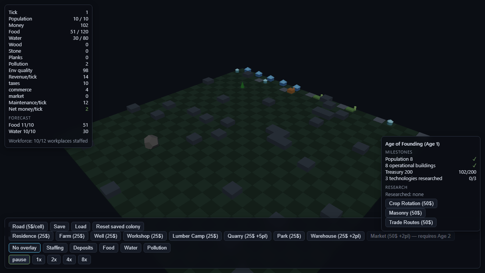
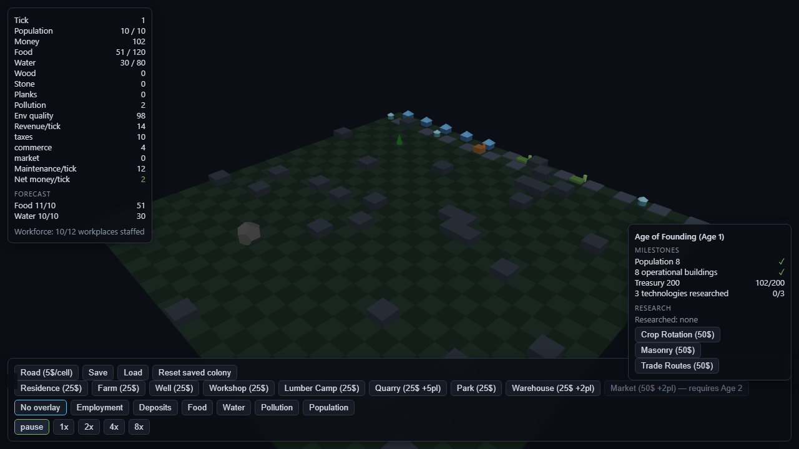

# Step043 — Visual Polish (readable roads + population/employment overlays)

Baseline: `d0d646c` (Step042 decision document). Executes **Option A**
of `docs/roadmap/Step042-visual-polish-events-decision.md`: the two
proven presentation gaps, zero mechanics, zero save migration — roads
that read as one network, and the overlays the UI-UX plan (§6)
promised. Events work stays parked pending product decisions D1–D5.

## 1. What shipped

**`src/renderer/atmosphere.ts`** — the per-age chapter palette now
covers roads (Step042 §2 "roads join the chapter"):

| Age | plate | lane (raised stripe) |
|---|---|---|
| 1 Founding | `0x4a5462` | `0x6e7a8a` |
| 2 Expansion | `0x5c4c3c` | `0x8a7458` |
| 3 Prosperity | `0x6b5a34` | `0x9a8448` |

**`src/renderer/renderer.ts`** — `buildRoads` reads as a network:
full-tile plates (no inter-cell seams), a raised lane stripe for
hierarchy, colors derived from the live age atmosphere. The two
geometries are shared across the whole network per rebuild;
`disposeGroup`'s per-mesh dispose is idempotent, so sharing is safe.

**`src/renderer/overlay.ts`** — new `population` mode, pure like the
others: operational residences green while housing has room, amber when
`population >= housingCapacity` (growth capped by construction — the
admission gate made visible), gray when mothballed;
under-construction never tints. Note: the default D2 colony boots at
exactly 10 pop / 10 beds, so the overlay opens amber and points the
player at residences.

**`src/app/ui/controlsPanel.ts`** — "Staffing" renamed **Employment**
(what the overlay actually shows; the staffing word stays in inspector
rows), and its legend now covers road-loss idles ("no workers or no
road"). New Population button + legend.

**`src/application/persistence/preferences.ts`** — `population` joins
`OVERLAY_IDS`; preferences saved with the new id survive reload, older
stored payloads parse per-field as before (no migration).

## 2. Tests

- `tests/overlay.test.ts` **+4**: population mapping — ok while room,
  warn when capped, off when mothballed, untinted while building.
- `tests/atmosphere.test.ts`: the 3 age pins extended with
  `road`/`roadLane`, **+1** invariant (lane brighter than plate in
  every age — the readability contract).
- `tests/preferences.test.ts`: stored-modes pin, parse and coerce
  extended to `population`.
- `e2e/interaction.spec.ts` **+2** (31→33): the population toggle
  persists across reload with zero page errors; the employment control
  carries its new label + road-aware legend and every advertised mode
  drives the scene (each click rebuilds the tinted meshes, so renderer
  errors surface).

## 3. Captures (deterministic scene: 10-cell road cross via diagnostics)

| Before (`d0d646c` renderer) | After (Step043) |
|---|---|
|  |  |

Before: 0.9-tile plates, gaps at every cell seam, one flat gray at any
age. After: continuous plates, raised lane stripe, Age-1 night-blue
tint. The BEFORE frame was recaptured from the exact HEAD tree (working
set stashed) so the pair shows the renderer change and nothing else.
The scratch capture spec was used for both frames and then deleted —
the captures are the evidence, not a permanent screenshot test.

## 4. Validation (executed 2026-10-24)

- `pnpm typecheck` / `pnpm lint`: clean. `pnpm build`: PASS
  (tsc -p tsconfig.build.json + vite build).
- `npx vitest run`: **21 files / 283 tests** green (+5).
- `npx playwright test`: **33/33** scenarios (1.1m), zero page errors,
  on the exact committed tree.

## 5. Non-goals (per the Step042 decision)

Events (awaiting D1–D5), V2 per-age architecture, V3 couriers, V5
emissive/shadows.
